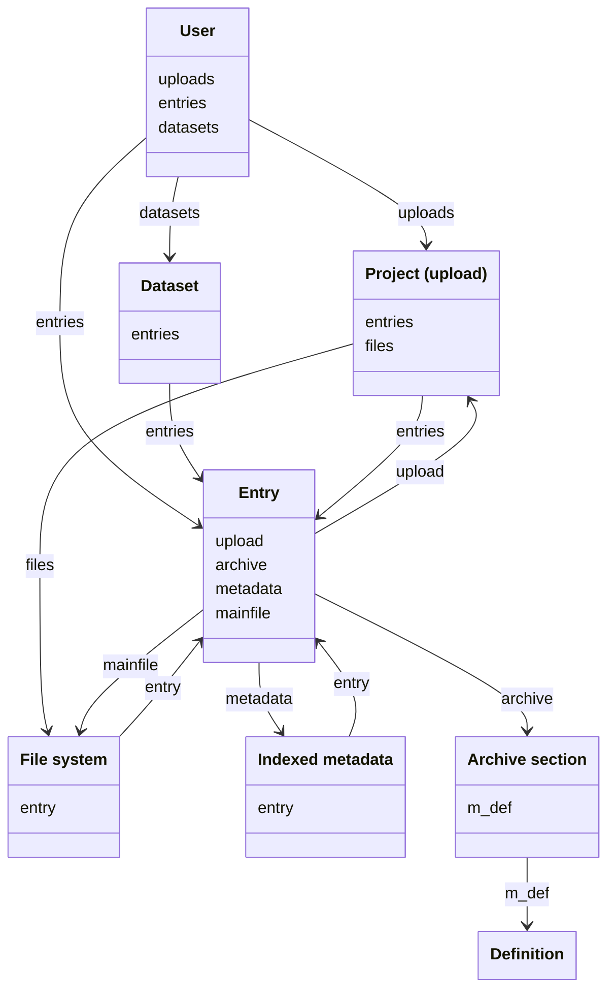

# Graph API traversal and responses

The Graph API connects NOMAD's stored resources in a single JSON request. It
is useful when a client needs selected information from several related
resources, such as a project's name and the archive data of its entries.
Ordinary REST endpoints remain suitable when a task needs just one resource;
`ArchiveQuery` offers bulk retrieval and schema-aware Python objects for
archive analysis.

The API is GraphQL-like in its ability to select fields and follow
relationships. It does not implement GraphQL's query language. Its selectors
also accommodate archive structures defined by installed schema packages.

## Data sources and relationships

A graph node is not necessarily a document in one database. A request can
cross several sources:

| Source | Information | Graph access |
| --- | --- | --- |
| Processing records (MongoDB) | Project and entry identifiers, processing state, ownership, and file paths | `uploads` and `entries` |
| Search index (Elasticsearch) | Searchable entry metadata and normalized scientific quantities | `search`, or `metadata` beneath an entry |
| Stored archives | Processed data organized by the entry's schema | `archive` beneath an entry |
| Project files | Directory and file information | `files` beneath a project, or `mainfile` beneath an entry |
| Metainfo | Definitions needed to interpret archive sections and quantities | `m_def` beneath an archive section, or `metainfo` at the root |

The following UML-style diagram shows the kinds of resources connected by the
Graph API. Each box lists navigation tokens, not the resource's complete data
fields. Arrows show which resource a token reaches; they do not represent data
flow, inheritance, or ownership. This is a resource map, not a sequence of
steps that every request must follow.

<figure markdown style="width: 100%">

<figcaption>Selected resource types and navigation tokens exposed by the Graph API. Other relationships and ordinary data fields are omitted.</figcaption>
</figure>

Root keys such as `users`, `uploads`, `entries`, and `datasets` select
collections of resources, whose records are keyed by ID. The `search` root
selects indexed entry metadata: `search/<entry-id>` and
`entries/<entry-id>/metadata` reach the same kind of resource, shown once in
the diagram. The `entry` token provides the return path from indexed metadata
to the entry's processing record.

Collection tokens such as `entries` require a record ID or a collection
selection before continuing. Single-resource tokens such as `upload`,
`archive`, and `metadata` do not require another ID. The `files` token opens a
project's directory tree, whereas `mainfile` starts at the entry's mainfile.
The file-system `entry` token reaches an associated entry only when the file
is recognized as a mainfile. Within an archive, subsection names navigate the
section hierarchy, and `m_def` retrieves the definition of the selected
section, not just the archive root.

`uploads` is the backend resource corresponding to GUI projects, not an
additional user-facing container. `datasets` is a separate resource for
collections of entries. The REST API supports dataset creation and, where DOI
services are configured, DOI assignment. The current GUI no longer creates
datasets; it uses projects with included entries instead.
User and group resources provide additional relationships, such as
`users/me/uploads`.

## Selection and response assembly are related but distinct

A graph request combines three decisions:

1. **Where to start and which relationships to follow.** Resource keys,
   identifiers, and edges such as `entries`, `upload`, and `archive` establish
   the data source and scope.
2. **Which records to include.** A collection's `m_request.query` filters
   records, and pagination limits the current result page.
3. **Which fields to return and whether to resolve references.** The request
   tree selects fields, and `m_request` configures their retrieval.

These are not independent query and formatting languages. In particular,
`directive: plain` does not choose the database or define a join. It requests
the selected value without following its archive references. The surrounding
tree determines the response nesting. Two selected project fields appear
together beneath the same `uploads/<project-id>` key because they share that
parent in the request.

For ordinary field selection, the response mirrors the selected paths.
Collection keys become maps keyed by resource IDs, with `m_response` alongside
the records for query and pagination information. Schema retrieval and
reference resolution can add data outside the originally selected path.
Consequently, a graph response is not always an exact copy of the request
tree with leaf values substituted.

## Wildcard fetching is not a fuzzy text search

The old terms *fuzzy fetching* and *fuzzy querying* describe different
operations:

- A `"*"` key applies a field selection to the records on a collection's
  current page. The client does not need their IDs in advance.
- A `query` filters the records before that selection is applied. Its syntax
  depends on the collection: entry processing records have different filters
  from the search index.

Neither term implies approximate string matching. Explicit record IDs are
also different from collection queries: an ID directly selects a resource,
whereas a query enumerates a filtered, paginated collection. Both remain
subject to access control.

## Search metadata is not the archive

`search` runs an entry metadata search and exposes its hits as graph nodes.
It uses the entry-search request's ownership, criteria, pagination, and
field-selection settings. The graph response exposes hits and pagination,
not the full REST search response, including aggregation results. It is not
a full-text search over arbitrary archive content.

The index may contain deeply nested scientific quantities. They can be
selected within the search hit just like other nested fields. For a known
entry, the `metadata` edge also exposes that entry's indexed metadata; a
top-level search is not required.

To retrieve the stored archive from a search hit, the path is
`search/<entry-id>/entry/archive`. The `entry` edge switches from an indexed
hit to the processing record that identifies the archive. When starting at
`entries/<entry-id>`, the path is simply `archive`. The intermediate `entry`
is therefore a property of the search-hit route, not a universal requirement
for every archive request.

The two paths `entries/<entry-id>/metadata` and
`entries/<entry-id>/archive/metadata` use different sources even when some of
their fields have the same names. Index availability and archive availability
can differ; a visible search hit does not guarantee permission to read an
embargoed archive or its raw files.

## Archive references can expand the response

An archive reference identifies a section or quantity in the same archive or
another entry. Plain retrieval retains the reference. Resolution retrieves
its target and writes it into a shared response subtree rooted at
`uploads/<upload-id>/entries/<entry-id>/archive`. The reference is rewritten
to point to that location in the same response.

This avoids inlining the same target repeatedly when several paths refer to
it. It also means clients must distinguish response-local references from
URLs and from `__INTERNAL__:` markers for data omitted by retrieval limits.
Resolution remains bounded by access permissions, the requested fields, and
any resolution limits.

## Related pages

- {{ nav_link("howto/manage/program/graph_api.md", breadcrumb=True) }} — retrieve related data in practice.
- {{ nav_link("reference/graph_api.md", breadcrumb=True) }} — exact request and response conventions.
- {{ nav_link("explanation/data.md", breadcrumb=True) }} — entries, archives, and schemas.
- {{ nav_link("explanation/auth.md", breadcrumb=True) }} — visibility and permissions.
