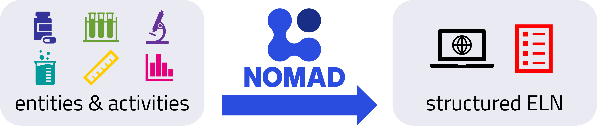
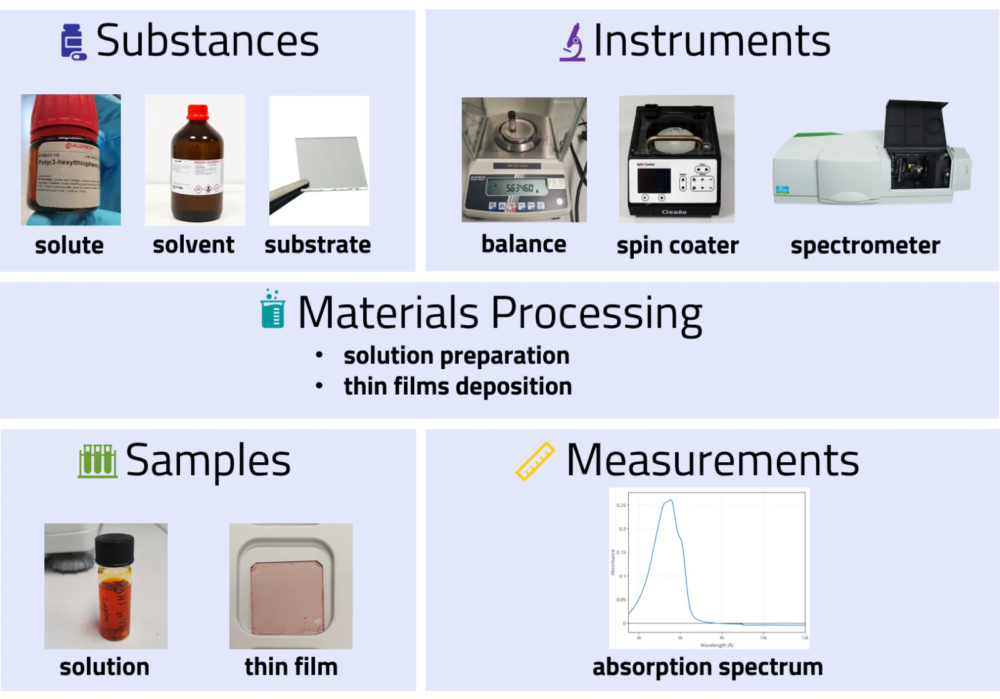
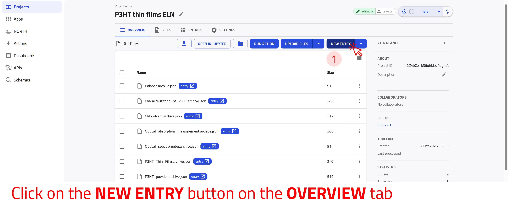
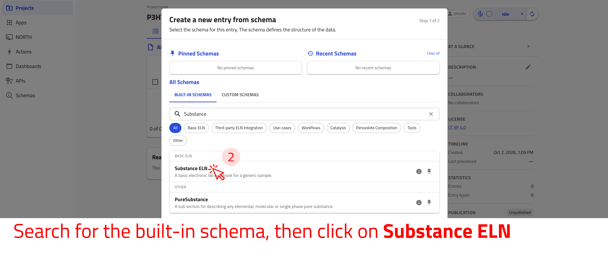
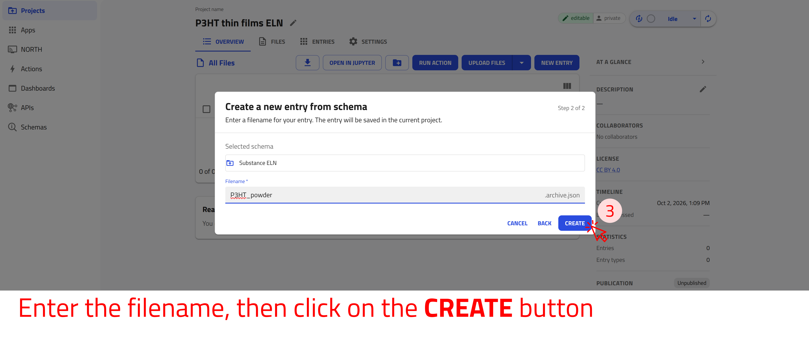
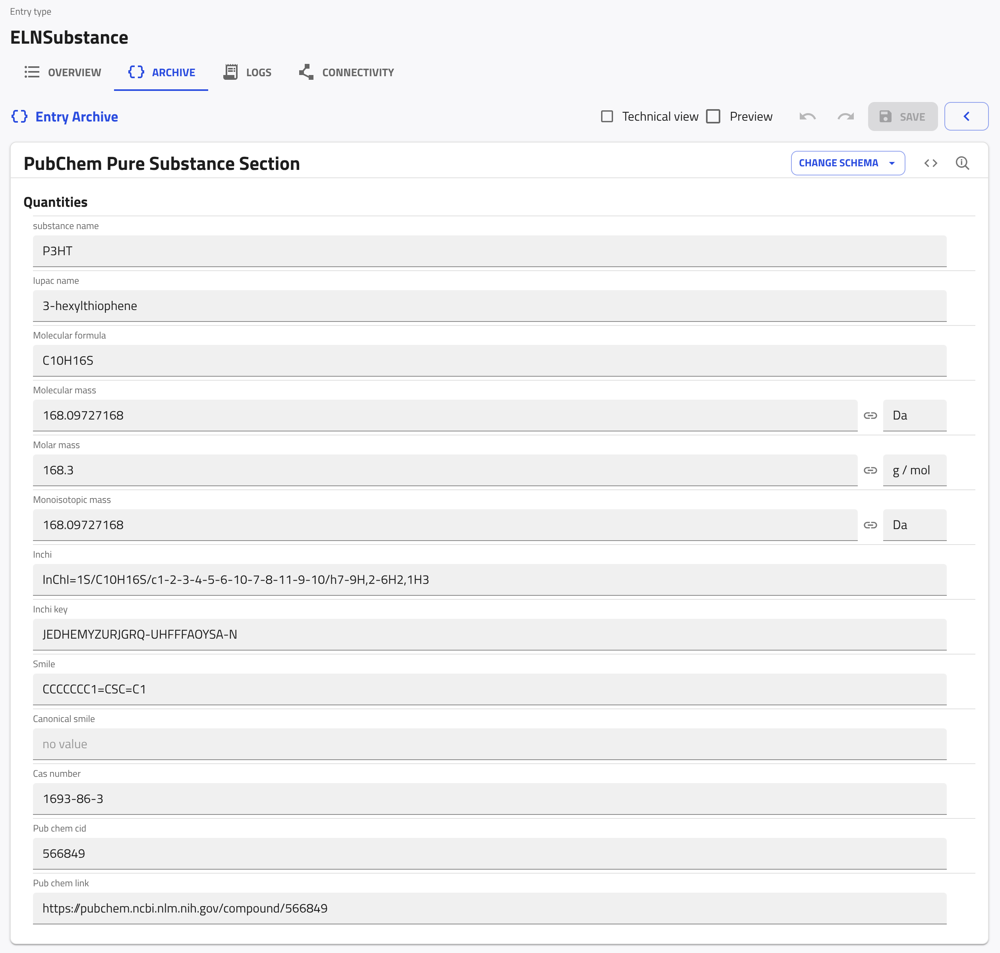
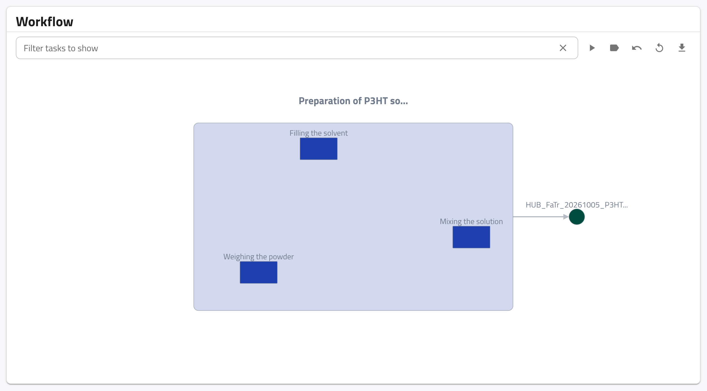
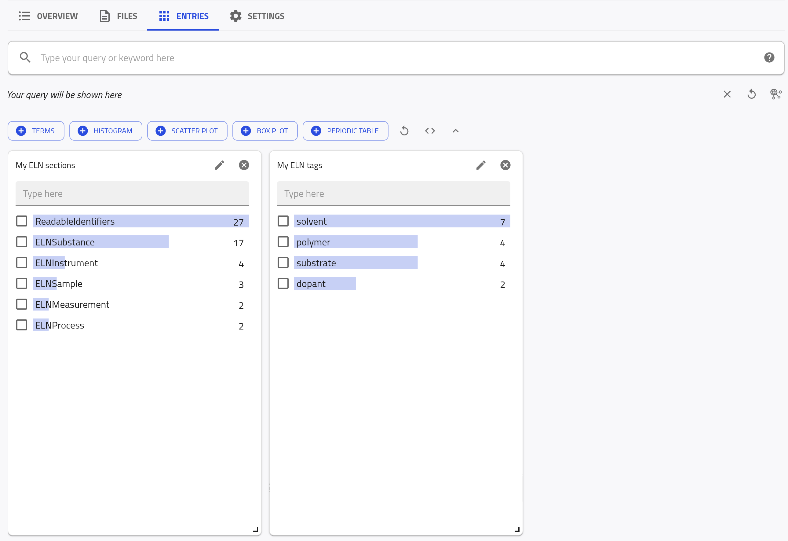

# Use built-in ELN templates in NOMAD

In this tutorial, we use NOMAD’s Electronic Lab Notebook (ELN) functionality to document an experiment in the NOMAD GUI. We follow the experimental workflow from defining substances and instruments to recording processing steps and measurements, using built-in ELN templates to structure and interlink the resulting entries. By the end of the tutorial, we will have documented an example experiment as a coherent, navigable ELN record in NOMAD.

---

## What you will learn

In this tutorial, you will learn how to:

1. Create and manage an ELN project in NOMAD
2. Create ELN entries for substances, samples, instruments, processes, and measurements using built-in schemas
3. Reference and interlink ELN entries to represent complete experimental workflows
4. Document material processing steps and visualize them using workflow graphs
5. Combine processes and measurements into a single experiment entry
6. Search, filter, and explore your ELN entries using the NOMAD GUI and custom widgets

---

## Before you begin

This tutorial requires no prior experience with NOMAD.

Before starting, make sure you have:

1. **NOMAD user account**  
   Creating and editing ELN entries requires a NOMAD user account.
   You can create an account by following the steps described in the
   [How-to guides > ... > Create a NOMAD account](../../howto/manage/gui/account.md#create-a-nomad-account).

2. **Basic familiarity with experimental workflows**  
   Familiarity with preparation, processing, and measurements can be helpful, but is not required.

This tutorial uses an example experiment involving the preparation of solution-processed polymer thin films and the measurement of their optical absorption spectrum.

??? example "About the example experiment used for this exercise"
    This exercise uses an example experiment involving the preparation and characterization of poly(3-hexylthiophene-2,5-diyl) (P3HT) thin films. The experiment consists of three main activities: preparing solutions, depositing thin films, and measuring optical absorption.

    1. **Preparing solutions:** The polymer powder is mixed with a solvent in predefined quantities to achieve the desired concentration. A scale is used to accurately weigh the polymer powder, ensuring precise solution concentration.

    2. **Depositing thin films:** The prepared solution is used to create a thin film on a glass substrate through spin-coating. By carefully controlling the spin speed and duration, the desired film thickness is achieved.

    3. **Measuring optical absorption:** The optical absorption spectrum of the thin film is acquired using a UV-Vis-NIR spectrometer. The measurement results are saved as a `.csv` file for further analysis.

    To effectively document this experiment, you will create and interlink electronic lab notebook (ELN) entries in NOMAD. These entries will include key entities such as substances, instruments, and samples, as well as activities like material processing and measurements. By structuring the data in this way, you get a comprehensive and FAIR-compliant record of the experiment.

    

---

## Create a new ELN project

Create a NOMAD project to contain the ELN entries and files related to your experiment. Follow the steps in [Tutorials > ... > Create a new project](../upload_publish.md#create-a-new-project) and name the project `P3HT thin films ELN`.

## Create ELN entries

Next, create entries for the substances, samples, instruments, processes, and measurements in your experiment. Each entry uses a *built-in schema*, a template that provides predefined fields and supports consistent documentation.

To create an ELN entry from a built-in schema:

1. Click **NEW ENTRY** on the **OVERVIEW** tab of your project page.
2. Open the **BUILT-IN SCHEMAS** tab and select the built-in schema for your entry. To find a schema, enter its name in the **Search schemas** field.
3. Enter a **Filename** and click **CREATE**. NOMAD adds the `.archive.json` extension to the filename.

NOMAD creates the entry and opens it. You can then fill in its fields.

**Use the arrow buttons ⬅️➡️ below to follow the steps for creating an ELN entry from a built-in schema.**

    
←

    
    
    
    
→

The following sections refer to these steps and tell you which built-in schema and filename to use for each entry.

### Create a substance entry

Create an entry for the **P3HT powder**. Follow the steps in [Create ELN entries](#create-eln-entries): select **Substance ELN** as the built-in schema and enter `P3HT_powder` as the **Filename**.

NOMAD creates and opens the entry. You can then fill in its fields and click **SAVE** to save your changes.

NOMAD automatically fills in the **substance name** (from the filename), the **Datetime**, and the **substance ID**. You can edit these values if needed. Complete the substance entry as follows:

1. Enter `Regioregular poly(3-hexylthiophene-2,5-diyl) powder for preparing P3HT solutions.` in the **detailed substance description** field. Optionally, add an image of the substance or its chemical structure to this field.
2. Click the **(+)** button next to the **Tags** field and enter `polymer`. Tags improve the searchability of your entries.
3. Click the **(+)** button next to **Pure substance** under **Subsections**.
4. Click **CHANGE SCHEMA** and select **PubChem Pure Substance Section**.
5. Click the check mark (✓) next to **CHANGE SCHEMA** to confirm your selection.
6. Enter `P3HT` in the **substance name** field.
7. Click **SAVE**.

NOMAD searches PubChem for the substance name and fills in the other fields, e.g., **Iupac name**, **Molecular formula**, **Molar mass**, and **Cas number**. For `P3HT`, PubChem provides the data of its monomer, 3-hexylthiophene.

??? task "Create an ELN entry for substances"
    Create an ELN entry with the *Substance ELN* schema for each of the following substances. Use the given filenames:

    - Chloroform: `Chloroform`
    - Glass substrate: `Glass_substrate`

    Include as many details as you like, e.g., a **detailed substance description** and **Tags**. For chloroform, add a **Pure substance** subsection with the *PubChem Pure Substance Section*, and enter `chloroform` as its **substance name**.

---

### Create a sample entry

Create an entry for the **P3HT thin film**. Follow the steps in [Create ELN entries](#create-eln-entries): select **Generic Sample ELN** as the built-in schema and enter `P3HT_Thin_Film` as the **Filename**.

Fill in the fields of the sample entry in the same way as for the substance entry. In addition, reference the substance from which the thin film is made:

1. Click the **(+)** button next to **Components** under **Subsections**.
2. Click **CHANGE SCHEMA** and select **SystemComponent**.
3. Click the check mark (✓) next to **CHANGE SCHEMA** to confirm your selection.
4. Click the pencil icon at the right end of the **System** field.
5. Click **This project** in the **Select section** dialog to show only the entries of your project.
6. Click `P3HT_powder.archive.json`, and then click **Substance ELN (./data)** below it.
7. Click **SAVE**.

The **System** field now references the `P3HT_powder` entry, and NOMAD fills in the **component label** with the substance name.

You can reference other entries in the same way wherever an ELN field refers to another entry, e.g., to instruments, samples, or input substances.

??? task "Create an ELN entry for a sample"

    Create an ELN entry for the P3HT solution in chloroform with the *Generic Sample ELN* schema and the filename `P3HT_solution_in_CF`. Reference its components, the `P3HT_powder` and `Chloroform` entries, in the same way as above: add one component, click **SAVE**, click **data** in the path at the top, and add the second one.

    Include as many details as you like, e.g., a **Description** and **Tags**.

---

### Create an instrument entry

Create an entry for the **balance** that is used to weigh the polymer powder. Follow the steps in [Create ELN entries](#create-eln-entries): select **Instrument ELN** as the built-in schema and enter `Balance` as the **Filename**.

As for the substance entry, NOMAD has already filled in the **name**, the **Datetime**, and the **ID**. Fill in further fields, e.g., **Description** and **Tags**, and click **SAVE**.

??? task "Create an ELN entry for an instrument"
    Create an ELN entry with the *Instrument ELN* schema for each of the following instruments. Use the given filenames:

    - Optical spectrometer: `Optical_spectrometer`
    - Spin coater: `Spin_coater`

    Include as many details as you like, e.g., a **Description** and **Tags**.

---

### Create a process entry

Create an entry for the **preparation of the P3HT solution** process. Follow the steps in [Create ELN entries](#create-eln-entries): select **Material Processing ELN** as the built-in schema and enter `Preparation_of_P3HT_solution` as the **Filename**.

Enter the process start time in **starting Time** and complete additional fields, such as **Location**, **Description**, and **Tags**. Then reference the `Balance` entry as the instrument used to weigh the powder:

1. Click the **(+)** button next to **Instruments** under **Subsections**.
2. Keep **InstrumentReference** and click the check mark (✓) next to **CHANGE SCHEMA** to confirm it.
3. Reference the `Balance` entry in the **instrument reference** field, in the same way as you referenced the P3HT powder in the sample entry.
4. Click **SAVE**, and then click **data** in the path at the top to return to the process.

??? task "Reference a sample to your process ELN"
    For the process entry created above, reference the sample entry `P3HT_solution_in_CF` in the **Samples** subsection, click **SAVE**, and then click **data** in the path at the top to return to the process. NOMAD then shows this sample as the output of the process in the workflow graph, as described below.

    If this sample entry does not exist yet, first create it with the *Generic Sample ELN* schema, as described in the sample task above.

**Defining the steps of a process**

The **Steps** subsection records each stage of a process and displays the stages in an interactive workflow graph.

Add the following steps to the **Preparation of P3HT solution** process:

1. Weighing the powder
2. Filling the solvent
3. Mixing the solution

To add the steps:

1. Click the **(+)** button next to **Steps** under **Subsections**.
2. Enter `Weighing the powder` in the **step name** field.
3. Enter `minute` in the unit field next to **Duration**, select it from the list, and enter `5` as the duration.
4. Click **SAVE**.
5. Click **data** in the path at the top to return to the process, and add the other two steps in the same way: `Filling the solvent` with a duration of `2` minutes and `Mixing the solution` with a duration of `30` minutes.

You can also fill in the **starting time** and a **Comment** for each step. If you enter a **Duration** for every step, NOMAD calculates the **starting time** of each step from the process **starting Time** and fills in the process **ending time**.

NOMAD uses the steps to create a workflow graph. To view it, click the **OVERVIEW** tab of the entry and scroll down to the **Workflow** card. The process steps appear as tasks, and entries referenced under **Samples**, such as `P3HT_solution_in_CF`, appear as outputs.

---

### Create a measurement entry

Create an entry for the **optical absorption measurement**. Follow the steps in [Create ELN entries](#create-eln-entries): select **Measurement ELN** as the built-in schema and enter `Optical_absorption_measurement` as the **Filename**.

Complete the measurement fields, such as **starting Time**, **Location**, **Description**, and **Tags**. Then add the instrument and measurement result:

1. Click the **(+)** button next to **Instruments** under **Subsections**.
2. Keep **InstrumentReference** and click the check mark (✓) next to **CHANGE SCHEMA**.
3. Reference the `Optical_spectrometer` entry from the instrument task in the **instrument reference** field, in the same way as you referenced entries before, and click **SAVE**.
4. Click **data** in the path at the top, and then click the **(+)** button next to **Results**.
5. Enter `Absorption spectrum` in the **name** field and `Absorption maximum at 552 nm.` in the **Result** field. You can also add images to the **Result** field.
6. Click **SAVE**.

---

### Integrate your experiment

Once all substances, samples, processes, and measurements are defined, you can integrate them into a structured workflow using the *Experiment ELN* schema. The *Experiment ELN* schema allows linking *processes* and *measurements* into a single entry for a comprehensive overview of your experimental workflow.

Create an entry for the **characterization of P3HT**. Follow the steps in [Create ELN entries](#create-eln-entries): select **Experiment ELN** as the built-in schema and enter `Characterization_of_P3HT` as the **Filename**.

The **Steps** subsection references the processes and measurements that make up the experiment and defines their order in the workflow.

Add `Preparation_of_P3HT_solution` and `Optical_absorption_measurement` as steps of your experiment in the order in which they were performed:

1. Click the **(+)** button next to **Steps** under **Subsections**.
2. Reference `Preparation_of_P3HT_solution` in the **Activity** field, in the same way as you referenced entries before.
3. Click **SAVE**.
4. Click **data** in the path at the top, and add a second step for `Optical_absorption_measurement` in the same way.

NOMAD fills in the **step name**, the **starting time**, and the **activity ID** of each step from the referenced entry.

---

## Explore and search your ELN

<!-- TODO consider changing this admonition to a download button -->
??? example "Download the example file for this exercise"
    Download the [example ELN data](https://github.com/FAIRmat-NFDI/FAIRmat-tutorial-16/raw/refs/heads/main/tutorial_16_materials/part_4_files/example_NOMAD_ELN.zip){:target="_blank" rel="noopener"}.

    The ZIP file contains several NOMAD ELN entries in `.json` format.

    These entries have been created using the NOMAD ELN built-in schema, organized into folders, and categorized with custom tags.

    To follow the search example below, create a new project named `Example NOMAD ELN` and upload the example file with **UPLOAD FILES**. Continue when the processing status shows **Completed**.

Use the **ENTRIES** tab to search and filter the substances, samples, instruments, processes, and measurements in your project.

First, add two terms widgets to filter the project entries by ELN section type and custom tag:

1. Open the **ENTRIES** tab of the `Example NOMAD ELN` project.
2. Click **TERMS**.
3. Enter `eln` in the **Search quantity** field and select `results.eln.sections`.
4. Enter `My ELN sections` in the **Title** field and click **DONE**.
5. Click **TERMS** again.
6. Enter `eln` in the **Search quantity** field and select `results.eln.tags`.
7. Enter `My ELN tags` in the **Title** field and click **DONE**.

You now have a search interface that supports keyword searches and filtering by ELN section type and custom tags.

To filter the entries, select `polymer` in the **My ELN tags** widget. Then enter `P3HT` in the search bar and press **Enter**. NOMAD displays entries that match both the selected tag and the search term. In this example, only the `P3HT` entry is left.

---
